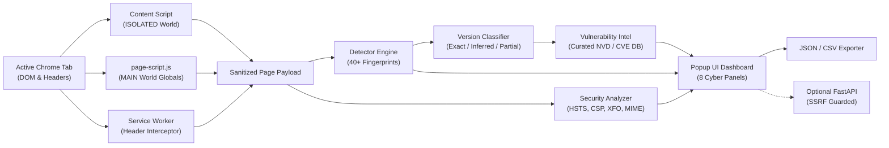

# Security Analyzer

<p align="center">
  
</p>

<p align="center">
  <a href="#-chrome-extension-manifest-v3"></a>
  <a href="#-test-verification"></a>
  <a href="#-privacy--ssrf-protection"></a>
  <a href="#-strict-project-file-budget"></a>
  <a href="#-license"></a>
</p>

---

## ⚡ Executive Summary

**Security Analyzer** is an advanced, non-destructive cybersecurity extension engineered exclusively for **Google Chrome using Manifest V3**. It detects publicly observable website technologies, programming runtimes, backend frameworks, script libraries, server banners, and defensive security configurations through passive inspection and safe, controlled probes.

Built for **cybersecurity researchers, penetration testers, bug bounty analysts, and DevSecOps practitioners**, Security Analyzer bridges the gap between passive tech-stack reconnaissance (Wappalyzer/WhatRuns) and offensive posture evaluation without performing intrusion attempts, credential stuffing, or destructive attacks.

---

## 📐 System Architecture

<p align="center">
  
</p>

### End-to-End Audit Workflow



---

## 🛡️ Core Capabilities

### 1. Wappalyzer-Style Technology Detection Engine
Analyzes public surface artifacts using deterministic matching across 92+ technology signatures in 14 distinct categories:

| Category | Fingerprinted Stacks & Components |
| :--- | :--- |
| **JavaScript Frameworks** | React, Next.js, Vue.js, Nuxt.js, Angular, AngularJS, Svelte, Alpine.js, Gatsby, Remix, SolidJS, Ember, Preact, Astro |
| **UI Frameworks** | Tailwind CSS, Bootstrap, Material-UI, Chakra UI, Ant Design, Bulma, Foundation, Font Awesome |
| **JavaScript Libraries** | jQuery, Lodash, Underscore, Axios, Moment.js, Day.js, core-js, RxJS, Three.js, Chart.js, D3.js, Modernizr |
| **CMS & Platforms** | WordPress, Drupal, Joomla, Shopify, Ghost, Magento, WooCommerce, Webflow, Squarespace, Wix |
| **Analytics & RUM** | Google Analytics (GA4/Universal), Google Tag Manager, Matomo, Plausible, Segment, Mixpanel, Hotjar, Sentry, Datadog RUM, Microsoft Clarity |
| **Advertising** | Google AdSense, Google Publisher Tag (GPT), Facebook Pixel, Criteo |
| **Security Services** | Cloudflare Turnstile, Google reCAPTCHA, hCaptcha, Cloudflare Bot Management |
| **CDN & Caching** | Cloudflare, AWS CloudFront, Fastly, Akamai, KeyCDN |
| **Hosting & PaaS** | Vercel, Netlify, GitHub Pages, Heroku, Firebase Hosting |
| **Web Servers** | Nginx, Apache HTTP Server, LiteSpeed, Caddy, Microsoft IIS, Cloudflare Server |
| **Programming Languages** | JavaScript, TypeScript, PHP, Python, Java, Ruby, Go (Golang), C# (.NET) *(Identified purely from objective runtime/header/file evidence; never inferred from frameworks)* |
| **APIs & WebSockets** | Socket.io, Pusher |
| **PWA & Performance** | Progressive Web App (PWA), webpack, Vite |

For every detected technology, Security Analyzer provides:
- **Component Name & Category**
- **Detected Version** (with honest attribution)
- **Granular Evidence Trail** (exact header matches, generator meta tags, script asset URLs, DOM selectors, runtime global objects)
- **Heuristic Confidence Score** (0% – 100%)
- **Primary Detection Method**
- **Uncertainties & Contextual Limitations**

---

### 2. Evidence-Based Version Detection
To eliminate false confidence, software versions are strictly classified into four operational states:

```
[Software Version Signal]
       │
       ├─► Exact     ─── Confirmed by runtime objects (React.version, window.jQuery.fn.jquery)
       ├─► Inferred  ─── Deduced from asset query parameters (?ver=6.2.0) or script paths
       ├─► Partial   ─── Major or minor release branch identified (e.g. Apache/2.4.x)
       └─► Unknown   ─── Presence verified; version masked or unexposed
```

> [!IMPORTANT]
> **Zero Hallucination Policy**: Security Analyzer never invents software versions. It does not deduce server-side Python, PHP, or Java runtime versions from client-side DOM when reliable evidence is absent.

---

### 3. Non-Destructive Security Configuration Analyzer
Evaluates client-side security postures and public HTTP response headers:

- **Content Security Policy (CSP)**: Audits absence of CSP, report-only mode, `'unsafe-inline'` script allowances, `'unsafe-eval'` dynamic string evaluation, and wildcard (`*`) origins.
- **Strict Transport Security (HSTS)**: Evaluates HTTPS enforcement, detects missing policies, short `max-age` durations (< 1 year), and uncommitted `includeSubDomains`.
- **MIME-Sniffing Prevention**: Checks for `X-Content-Type-Options: nosniff`.
- **Clickjacking Defense**: Analyzes `X-Frame-Options` (`DENY` / `SAMEORIGIN`) and CSP `frame-ancestors` directives.
- **Referrer-Policy**: Checks for permissive referrer leakages (`unsafe-url` / `no-referrer-when-downgrade`).
- **Permissions-Policy**: Identifies unconstrained hardware access (geolocation, camera, microphone).
- **Information Disclosure**: Flags server banner leaks (`Server: Apache/2.4.52 (Ubuntu)`), `X-Powered-By: PHP/8.1.2`, and `X-AspNet-Version`.
- **Legacy Components**: Flags known high-risk libraries (jQuery < 3.5.0 vulnerable to DOM XSS, End-of-Life AngularJS 1.x).

---

### 4. Vulnerability Intelligence (CVE Correlation)
Correlates identified software components and confirmed version numbers against trusted vulnerability sources:

- **Offline-First Curated Feed**: Pre-compiled database of verified CVEs (`CVE-2020-11022`, `CVE-2021-41773`, `CVE-2023-25690`, `CVE-2022-21661`, `CVE-2023-3824`).
- **Scoring & Impact**: CVSS v3 severity metrics, affected version ranges, official advisory URLs, and remediation steps.
- **Graceful OSV Fallback**: Supports real-time OSV.dev public queries with timeouts and rate-limit fallbacks.
- **Responsible Disclosure**: Findings explicitly identify version correlations as *potential indicators* rather than confirmed exploits.

---

### 5. Safe Deep Scan
User-initiated, non-destructive surface probe with strict concurrency and timeout controls:

1. **RFC 9116 `security.txt` Discovery**: Checks `/.well-known/security.txt` and `/security.txt` to identify responsible vulnerability disclosure channels and contact keys.
2. **`robots.txt` Path Audit**: Parses exclusion directives disclosing administrative portals (`/admin/`, `/wp-admin/`, `/portal/`, `/api/`).
3. **Script Header Inspection**: Audits external JavaScript files for banner comments, author tags, and copyright releases.
4. **Safety Safeguards**: Enforces strict timeouts (3.5s), maximum concurrency (3 requests), and an instant cancellation trigger via `AbortController`.

---

### 6. Standardized Assessment Reporting
Generate and download audit reports in two industry formats:
- **JSON Report**: Comprehensive structured output complete with metadata, scores, findings, raw evidence, and disclaimers.
- **CSV Matrix**: Tabular matrix of technologies, versions, security gaps, and remediation actions.

> [!NOTE]
> **Privacy by Design**: Security Analyzer inspects only publicly exposed headers and DOM structures. It **never** reads, stores, or exports passwords, authentication tokens, session cookies, or user credentials.

---

## 🖥️ User Interface Overview

The extension popup features a dark cybersecurity interface (`#0b0f19`) with emerald cyber-green accents (`#10b981`), organized into 8 functional panels:

```
┌─────────────────────────────────────────────────────────────┐
│ 🛡️ SECURITY ANALYZER                       [ GRADE: A (94) ] │
│ 🟢 https://example.com                       Scan: Just now │
├─────────────────────────────────────────────────────────────┤
│ [Overview] [Techs: 6] [Versions] [Security: 3] [CVE Intel]   │
│ [Deep Scan] [Export] [Settings]                             │
├─────────────────────────────────────────────────────────────┤
│                                                             │
│   ┌───────────────────┐  ┌──────────────────────────────┐  │
│   │   94 / 100        │  │  Technologies Identified: 6  │  │
│   │   Grade A         │  │  Security Findings:       3  │  │
│   │   Robust Posture  │  │  CVE Warnings:            0  │  │
│   └───────────────────┘  └──────────────────────────────┘  │
│                                                             │
│   Severity Breakdown:                                       │
│   [CRITICAL: 0] [HIGH: 0] [MED: 1] [LOW: 2] [INFO: 4]       │
│                                                             │
│   Identified Stack:                                         │
│   [WordPress 6.2.0] [Apache 2.4.52] [PHP 8.1.2] [jQuery]   │
│                                                             │
└─────────────────────────────────────────────────────────────┘
```

---

## 🚀 Installation & Getting Started

### 1. Load Extension in Google Chrome (Manifest V3)

1. Open **Google Chrome**.
2. Navigate to the extensions manager:
   ```text
   chrome://extensions/
   ```
3. Enable **Developer mode** via the toggle switch in the upper-right corner.
4. Click the **Load unpacked** button in the upper-left toolbar.
5. Select the project directory:
   ```text
   C:\Users\new\.gemini\antigravity\scratch\security-analyzer
   ```
6. **Security Analyzer** will appear in your installed extensions list.
7. Click the Chrome Extensions puzzle icon in the browser toolbar and pin **Security Analyzer**.
8. Navigate to any website (e.g. `https://wordpress.org` or `https://nextjs.org`) and click the icon to begin analysis.

---

### 2. Optional: Launching the Python Backend (FastAPI)

The extension is fully self-sufficient and operates without external dependencies. To enable optional backend capabilities:

```bash
# Navigate to the project root
cd C:\Users\new\.gemini\antigravity\scratch\security-analyzer

# Install minimal backend dependencies
pip install -r backend/requirements.txt

# Start the FastAPI server
uvicorn backend.main:app --host 127.0.0.1 --port 8000 --reload
```

- **Health Check**: Open `http://127.0.0.1:8000/api/health` to confirm the server is running.
- **Extension Settings**: Open the extension popup, go to **Settings**, and toggle **Use Python Backend When Available**.

---

## 🧪 Test Verification & Quality Assurance

The project includes an automated test suite executed with Python's unittest runner:

```bash
python -B -m unittest discover -s tests -v
```

### Verified Test Results

```text
test_health_endpoint (test_backend_ssrf.TestBackendAPI) ..................................... ok
test_scan_endpoint_blocks_ssrf (test_backend_ssrf.TestBackendAPI) ........................... ok
test_blocks_cloud_metadata (test_backend_ssrf.TestSSRFProtection) ........................... ok
test_blocks_localhost_and_loopback (test_backend_ssrf.TestSSRFProtection) .................. ok
test_blocks_non_http_schemes (test_backend_ssrf.TestSSRFProtection) ......................... ok
test_blocks_rfc1918_private_ips (test_backend_ssrf.TestSSRFProtection) ...................... ok
test_cve_correlation_logic (test_detector_and_engine.TestSecurityAnalyzerEngine) ............ ok
test_false_positive_prevention (test_detector_and_engine.TestSecurityAnalyzerEngine) ........ ok
test_json_and_csv_report_generation (test_detector_and_engine.TestSecurityAnalyzerEngine) ... ok
test_missing_evidence_and_unknown_tech (test_detector_and_engine.TestSecurityAnalyzerEngine)  ok
test_modern_nextjs_detection_from_fixture (test_detector_and_engine.TestSecurityAnalyzerEngine) ok
test_multicategory_known_fingerprints (test_detector_and_engine.TestSecurityAnalyzerEngine) . ok
test_negative_framework_does_not_invent_programming_language (test_detector_and_engine) .... ok
test_security_header_rules (test_detector_and_engine.TestSecurityAnalyzerEngine) ............ ok
test_version_classification_rules (test_detector_and_engine.TestSecurityAnalyzerEngine) ..... ok
test_version_evidence_integrity (test_detector_and_engine.TestSecurityAnalyzerEngine) ....... ok
test_wordpress_detection_from_fixture (test_detector_and_engine.TestSecurityAnalyzerEngine) .. ok
test_database_structure (test_manifest_and_fingerprints.TestFingerprintsDatabase) .......... ok
test_manifest_v3_specification (test_manifest_and_fingerprints.TestManifestIntegrity) ....... ok
test_referenced_files_exist (test_manifest_and_fingerprints.TestManifestIntegrity) .......... ok

----------------------------------------------------------------------
Ran 20 tests in 0.053s

OK (20/20 passed, 0 failures, 0 errors)
```

---

## 🔒 Privacy & SSRF Protection

Security Analyzer implements defense-in-depth principles:

- **Host Permission Minimization**: Restricts host permissions to active tab audit requests.
- **SSRF Prevention Engine (`backend/ssrf_guard.py`)**:
  - Resolves target hostnames via DNS before dispatching requests.
  - Rejects loopback addresses (`127.0.0.0/8`, `::1`).
  - Rejects RFC 1918 private subnets (`10.0.0.0/8`, `172.16.0.0/12`, `192.168.0.0/16`).
  - Rejects link-local and cloud metadata endpoints (`169.254.169.254`, `metadata.google.internal`).
  - Rejects non-HTTP schemes (`ftp://`, `file://`, `gopher://`).
- **No Embedded Secrets**: All API communications use standard public endpoints without hardcoded private API keys.

---

## 📁 Strict Project File Budget

> **Project Mandate**: The entire project directory must never exceed 99 files.

```text
security-analyzer/
├── .gitignore
├── manifest.json
├── README.md
├── assets/
│   ├── architecture.svg
│   ├── banner.svg
│   ├── icon.svg
│   ├── icon16.png
│   ├── icon48.png
│   └── icon128.png
├── background/
│   └── service-worker.js
├── content/
│   ├── content-script.js
│   └── page-script.js
├── engine/
│   ├── deep-scanner.js
│   ├── detector.js
│   ├── fingerprints.json
│   ├── reporter.js
│   ├── security-analyzer.js
│   ├── version-detector.js
│   └── vuln-intel.js
├── popup/
│   ├── popup.css
│   ├── popup.html
│   └── popup.js
├── backend/
│   ├── main.py
│   ├── requirements.txt
│   └── ssrf_guard.py
└── tests/
    ├── fixtures/
    │   ├── sample_modern_stack.html
    │   └── sample_wordpress_page.html
    ├── test_backend_ssrf.py
    ├── test_detector_and_engine.py
    └── test_manifest_and_fingerprints.py
```

- **Verified Total Files**: **30 files**
- **Strict Limit**: $\le$ 99 files
- **Remaining Allowance**: **69 files**

---

## 📜 Ethical Scope & Disclaimer

Security Analyzer is developed for defensive security assessment, technology reconnaissance, and educational use. The extension strictly performs passive inspection of publicly transmitted headers, scripts, and DOM elements. It does not perform active intrusion, bypass access controls, or execute exploit payloads. Automated findings do not guarantee an absolute state of security.

---

## 📄 License

This project is licensed under the **MIT License**.
